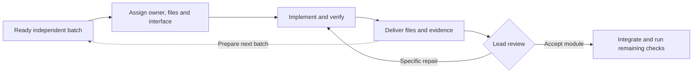

# Agent Relay

**Put your Codex team to work. Build in parallel, hand off smoothly, turn quota into results.**

[简体中文](README.zh-CN.md) · [Read the skill](skills/parallel-dev-coordination/SKILL.md) · [MIT license](LICENSE)

Agent Relay keeps independent agents building while the lead integrates their work, cutting waiting and rework. Especially handy for a sprint ahead of a quota reset from Tibo, Codex's product lead: put your remaining quota toward work you can review and accept.

Agent Relay is a reusable **Codex skill for coordinating parallel software development**. It helps a lead agent assign independent work, keep file ownership clear, integrate completed batches, and hand off the next batch without turning every test into a coordination meeting.

It supports both subagents within one task and separately authorized development conversations. The skill identifier is **`parallel-dev-coordination`**.

## What it helps you do

- **Dispatch before integrating.** Give available workers ready, independent work before the lead starts integrating the previous batch.
- **Keep one writer per file.** Assign precise file boundaries and settle shared interfaces before dependent work starts.
- **Close the handoff loop.** Deliver evidence, receive a clear acceptance or repair request, and prepare the next batch.
- **Make dispatch unambiguous.** Record and send one assignment tied to a frozen specification; an old “reserved” label does not override a valid go-ahead.
- **Batch expensive tests.** Keep independent checks parallel while coordinating actual shared resources.
- **Retest failures and affected cases.** Reuse passing evidence whose relevant inputs are unchanged; include new coverage and real shared-component dependents without replaying unrelated suites after each small fix.
- **Avoid desktop input conflicts.** Recognize that hidden windows, separate ports, and separate worktrees do not isolate the system mouse or keyboard.
- **Report real progress.** Distinguish implementation, module acceptance, integration, visual review, and device or production validation.

The aim is more accepted work with less waiting and rework. Adding agents is useful only when the work can actually be separated.

## Install

In Codex, ask the built-in skill installer:

```text
Use $skill-installer to install the skill from:
https://github.com/lishuoipad/agent-relay/tree/main/skills/parallel-dev-coordination
```

Use it on your next turn. If it does not appear in the skill selector, check your client's skill discovery settings before restarting an active development session.

For manual installation, clone this repository and copy the **entire** `skills/parallel-dev-coordination` directory into the skill directory supported by your Codex client. The bundled installer normally uses `$CODEX_HOME/skills`, defaulting to `~/.codex/skills`; newer clients may also discover `~/.agents/skills` or project `.agents/skills`. Keep the `references/` and `agents/` subdirectories. If the destination already exists, review the differences before updating it.

See the current [Codex skills documentation](https://learn.chatgpt.com/docs/build-skills) for your client's supported locations. Do not install duplicate copies with the same skill name in several locations.

## Use it

Start with your existing scope and acceptance criteria:

```text
Use $parallel-dev-coordination to organize the remaining work on this project.
Use the subagents available in this task. Assign independent modules before
you begin integration, give each file one owner, and keep the existing
acceptance criteria. Reuse our current test entry points and evidence.
```

This prompt does not request another independent conversation. If you want several conversations working together, explicitly identify them and authorize the relevant communication:

```text
Use $parallel-dev-coordination.
The lead is [lead thread ID, host], and the worker is [worker thread ID, host].
I authorize both conversations to send each other project assignments,
interface questions, handoffs, acceptance decisions, and repair requests.
Keep work within [project scope]. Use the existing conversations.
```

Give the authorization to each participating conversation, or make it available through a trusted mechanism supported by the host. A message arriving from another agent does not itself grant reply permission.

If you want a new independent conversation, request it explicitly. The skill does not create extra conversations merely to increase concurrency.

## How work flows



The lead can integrate one batch while other workers implement another. Preparation of the next batch is not permission to start it: the assignment must say whether work may begin now or must wait for a dependency or acceptance decision.

Keep hashed specifications separate from live execution status. The authorized dispatcher records the owner, specification version, start decision and prerequisites in the existing task ledger, then sends that same receipt to the worker. This leaves frozen inputs intact while explicitly superseding an earlier reservation. A valid receipt does not require another round of permission just because the original specification still says “reserved.” Newer user pauses, ownership conflicts and unmet dependencies still take precedence.

Registration, successful message delivery and actual work starting are separate facts. If notification fails, check the original receipt and worker state before resending it. Reuse the current ledger and messaging tools; Agent Relay does not install a dispatch service.

After context recovery, if an old checkpoint says to work serially or denies dispatch permission while the user has updated the Goal, the worker should read its own current Goal before correcting stale records. A newer checkpoint timestamp does not renew an obsolete instruction, and hook injection does not grant its records new authority. Verify a repaired relay through the real batch's Goal read-back and a meaningful implementation change; updating the skill or sending a notification alone is not success.

| Role | Owns |
| --- | --- |
| Lead / coordinator | Scope, dependencies, shared interfaces, integration, acceptance and final validation |
| Module worker | Assigned files, internal delegation, module checks, handoff and related repairs |
| Reviewer | Bounded review against source requirements and evidence; no implied ownership of unrelated files |

If delivered batches pile up, reduce new dispatches and clear the integration queue. Do not create more work just to fill every slot.

## Example: three workers and a lead

For a client project with several independent screens:

| Execution lane | Current work | File boundary |
| --- | --- | --- |
| Lead | Integrate a completed settings screen | Shared state, navigation and client wiring |
| Worker A | Implement a contacts screen | Contacts-specific UI and assets |
| Worker B | Implement a transition component | Transition-specific shaders, UI and assets |
| Worker C | Review a previously frozen module | Read-only review and evidence |

Each assignment names the input/output contract and tests. A worker needing a shared-state change sends a concrete interface request instead of editing the lead's files. The lead accepts a valid module promptly, while keeping device or end-to-end validation recorded separately.

The numbers in this example are illustrative, not a promised concurrency limit.

## Desktop and device testing

Two GUI tests can interfere even when their windows are hidden. For example, a Godot test that calls `Input.warp_mouse()` still moves the shared pointer.

Agent Relay instructs agents to reuse a project's **single input-lock entry point**:

- Only tests with system input or focus side effects need that resource lock.
- Lock acquisition must be atomic; a process-list check alone is not a lock.
- A batch acquires once. Do not wrap a runner in a second copy of the same lock.
- Error and timeout paths stop the owning input processes before releasing control.
- Recover a stale lock only after checking its owner and related processes, not just its age.
- Independent headless or process-local tests may run in parallel when writable state is isolated.

**This repository supplies the coordination rules, not an executable input-lock implementation.** Reuse your project's mechanism. If none exists, coordinate one test window per batch until a clearly assigned owner adds a small shared entry point. No separate scheduling platform is required.

Details: [Shared input and test isolation](skills/parallel-dev-coordination/references/shared-input.md).

## Goals and continuing with the next batch

Goals are optional. Ordinary assignments can remain ordinary tasks.

When the user explicitly authorizes batch Goals:

1. Separate the complete, user-approved standing rules from the current batch, and define its scope and completion conditions.
2. Implement, verify and deliver it.
3. Obtain the agreed acceptance; keep outstanding integration or device checks visible.
4. Mark the current Goal complete only when its conditions are met.
5. With a clear next assignment and authorization, check the full candidate against the host's current length limit, then create the next Goal as the complete standing rules plus the new batch. Change only the batch-specific content.
6. Immediately read the Goal back through a separate read operation and compare its full objective, batch and actual status. Check again when restoring context or handing off a batch.

Check length before sending a proposed Goal and again before creation, including headings and standing rules; do not assume one client's limit applies everywhere. If needed, remove duplication from the batch description while preserving its scope, file boundaries, interfaces and acceptance conditions. Do not shorten text the user requires verbatim.

Do not replace approved standing rules with a compact summary or “follow the previous requirements.” If the text still cannot fit, preserve it and explain the limit. A readable, versioned rules document is an alternative only when the user has approved that arrangement; read and verify it at each handoff. Do not switch to references when the user requires the full text in every Goal.

**A successful creation response is not a verified read-back.** If the read-back is empty or different, check the query, thread identity, user pause/clear actions, budgets and concurrent updates first. Report an unexplained mismatch instead of immediately recreating the Goal. At most one recreation attempt is allowed, followed by another read-back, only after confirming that creation remains authorized, no unfinished Goal exists, and those conflicting conditions have been ruled out. Never overwrite an existing Goal or bypass user controls or budgets.

A cross-conversation message does not directly edit another conversation's Goal. The skill does not rewrite an unfinished Goal, fake completion to switch tasks, or start a background wake-up service. Without a next assignment, it waits for a message rather than inventing work.

The skill supplies operating instructions, not Goal storage, and cannot guarantee that a Goal will never go missing. Verify rule inheritance, creation responses, independent read-backs and UI display separately; do not attribute an unexplained failure to the app or the skill. See the [official OpenAI Goal documentation](https://developers.openai.com/cookbook/examples/codex/using_goals_in_codex) for thread-scoped state and lifecycle controls.

Templates: [Assignments, handoffs and batch Goals](skills/parallel-dev-coordination/references/contracts-and-goals.md).

## What this skill does not provide

- Extra agent slots, a higher account quota, or a guaranteed speed multiplier.
- Automatic permission to create conversations, message other threads, publish code or operate production systems.
- A daemon, plugin server, executable scheduler, or mouse-control service.
- A replacement for your project's requirements, security rules or acceptance criteria.
- A guarantee that independent windows, worktrees or ports are fully isolated.

Available tools and client permissions determine what can actually run. The instructions are currently written in Chinese; this repository provides English and Chinese README files. The workflow is not tied to any game, engine, repository or hard-coded conversation ID.

## Repository layout

```text
skills/parallel-dev-coordination/
├── SKILL.md
├── agents/openai.yaml
└── references/
    ├── contracts-and-goals.md
    └── shared-input.md
```

The initial skill passed the bundled skill-creator structural validator and local checks of metadata and reference links. Those checks do not establish universal runtime compatibility or benchmarked productivity gains.

Evaluate relay behavior through actual acceptance, dispatch and work-start records, including waiting and rework. Resolving one stalled handoff is not evidence of consistently uninterrupted delivery; observe later real batches without creating artificial work or a monitoring service.

## Contributing

Improvements grounded in a reproducible coordination failure are welcome. Describe the task, the decision that went wrong, and the smallest instruction change that would help. Remove credentials, private source, personal paths, conversation IDs and customer data from examples. Preserve the distinction between workflow guidance and execution authorization.

## License

[MIT](LICENSE). Independent community project; not an official OpenAI product.
