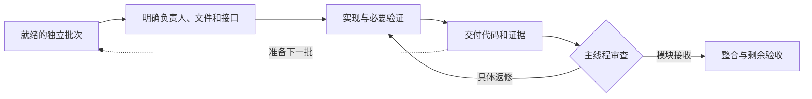

# Agent Relay · 智能体接力

**其他智能体继续开发，主线程接力整合。**

[English](README.md) · [技能正文](skills/parallel-dev-coordination/SKILL.md) · [MIT 许可](LICENSE)

Agent Relay 是一个用于 **Codex 并行软件开发协调**的技能。它把任务拆分、文件归属、交付接收、合批测试和下一批接续整理为可复用流程，减少空等、冲突和反复确认。

它适用于同一任务中的子智能体，也适用于用户已授权共同开发的独立对话。技能调用名称是 **`parallel-dev-coordination`**。

## 它解决什么问题

- **整合前先派工**：主线程开始整合上一批之前，先把就绪的独立任务交给可用执行者。
- **一个文件一个修改者**：提前划清专属文件和共享接口，减少覆盖与返工。
- **交付有人接收**：完整交付后及时给出接收或具体返修结论，同时准备下一批。
- **昂贵测试合批做**：独立检查并行，实际共享资源统一协调。
- **桌面输入不争抢**：隐藏窗口、不同端口和不同工作树，都不自动隔离系统鼠标与键盘。
- **进度有证据**：开发、模块接收、整合、图审、实机和线上验收分别记录。

目标是增加已接收成果、减少等待和返工；不是单纯让更多智能体显示为“运行中”。

## 安装

在 Codex 中对内置技能安装器说：

```text
使用 $skill-installer 安装以下技能：
https://github.com/lishuoipad/agent-relay/tree/main/skills/parallel-dev-coordination
```

下一轮对话即可尝试调用。若技能选择器尚未显示，先检查当前客户端的技能发现设置，避免直接重启正在开发的会话。

手动安装时，克隆仓库，将完整的 `skills/parallel-dev-coordination` 文件夹复制到当前客户端支持的技能目录，保留 `references/` 和 `agents/`。内置安装器通常使用 `$CODEX_HOME/skills`，未设置时为 `~/.codex/skills`；较新客户端也可能发现 `~/.agents/skills` 或项目内 `.agents/skills`。已有同名技能时先比较差异，不直接覆盖或在多个位置重复安装。

具体位置以当前 [Codex 技能文档](https://learn.chatgpt.com/docs/build-skills)和客户端为准。

## 开始使用

在已有项目中输入：

```text
使用 $parallel-dev-coordination 组织这个项目的剩余开发。
使用当前任务实际可用的子智能体，先分配独立模块再开始整合。
每个文件只安排一个修改者，保持原功能范围和验收标准，
复用现有测试入口与有效证据。
```

这段指令不会要求创建另一个独立对话。需要多个对话共同开发时，明确身份与通信授权：

```text
使用 $parallel-dev-coordination。
主协调对话是：[线程 ID、主机]。
并行开发对话是：[线程 ID、主机]。
我授权双方就本项目直接互发分工、接口问题、交付、接收及返修消息。
开发范围限定为：[具体范围]。复用已有对话。
```

将授权提供给参与的各个对话，或使用宿主支持的可信授权机制。收到另一智能体的消息，本身不构成回复授权。

需要新建独立对话时，应由用户明确提出；技能不会为增加并发名额不断新建对话。

## 工作方式



主线程整合上一批时，其他执行者可以开发下一批。必须区分“预留下一批”和“允许立即开工”：仍有依赖或尚未授权的任务，不能因为已经写入计划就直接开始。

| 角色 | 主要责任 |
| --- | --- |
| 主协调者 | 范围、依赖、共享接口、整合、接收和最终验收 |
| 模块执行者 | 归属文件、内部委派、模块检查、交付和相关返修 |
| 审查者 | 对照需求与证据进行有边界的审查，不自动取得其他文件修改权 |

如果待整合成果积压，先消化整合和返修，再增加派工。不为填满名额制造工作。

## 示例：一个主线程和三个执行者

| 执行者 | 当前工作 | 修改边界 |
| --- | --- | --- |
| 主线程 | 整合已经交付的设置窗口 | 共享状态、导航及客户端接线 |
| 执行者 A | 开发通讯录窗口 | 通讯录专属界面和素材 |
| 执行者 B | 开发过场组件 | 过场专属着色器、界面和素材 |
| 执行者 C | 审查此前冻结的模块 | 只读审查及证据 |

每批明确输入输出和检查条件。需要共享状态变化时，由执行者提出具体接口需求，主线程维护共享文件。模块符合交付条件就及时接收，实机和完整流程验收继续单独记录。

这里的数量只是示例，不代表固定或保证的并发额度。

## 桌面与设备测试

两个隐藏的 GUI 测试窗口也可能相互干扰。例如 Godot 中的 `Input.warp_mouse()` 仍会操作共享指针。

技能要求复用项目的**统一输入互斥入口**：

- 只有实际影响系统输入或焦点的测试需要该资源锁。
- 获取锁必须是原子操作；先查“没有进程”再启动，仍存在竞争窗口。
- 一批入口持锁一次，区分外层包装和自身持锁的 runner，避免重复加锁。
- 异常或超时先停止本方输入进程，再释放控制权。
- 回收失效锁须核对拥有者和关联进程，不能只看时间。
- 无界面或进程内测试，在可写状态隔离、无系统输入副作用时可以并行。

**本仓库提供协调规则，不包含可执行的输入锁实现。** 优先复用项目已有机制。尚无机制时，按批次约定一次测试时段，再由明确负责人补充小范围共享入口，不必建立另一套调度平台。

详见[共享输入与测试隔离](skills/parallel-dev-coordination/references/shared-input.md)。

## Goal 和下一批接续

普通任务不必强制建立 Goal。用户明确授权按批次使用 Goal 时：

1. 将用户确认的完整固定协作规则与当前批次分开，明确范围和完成条件。
2. 实现、验证并交付。
3. 取得约定接收，保留未完成的整合或实机验收事项。
4. 满足本批完成条件后，才将当前 Goal 标为完成。
5. 下一批分工及创建授权明确时，由对应对话创建“完整固定规则＋新批次”的 Goal，仅更新批次内容。
6. 创建后立即用独立读取工具核对完整正文、批次及状态；在上下文恢复和交接时再次核对。

不要用紧凑摘要或“沿用之前要求”代替已确认的固定规则。遇到宿主长度限制时保留原文并说明限制；只有用户已接受引用式承载，才改用可读取、版本明确的规则文档，并在接续时实际核对。用户要求全文保留时不能自行改成引用。

**创建返回成功不等于独立读回已验证。** 读回为空或不一致时，先检查查询、对话身份、用户暂停／清除、预算及并发更新；原因不明时报告，不直接重建。只有确认仍有有效授权、无未完成目标且排除了上述情况，才最多补建一次并再次读回。不得覆盖已有目标或绕过用户控制及预算限制。

跨对话消息不会直接改写另一个对话的 Goal。技能不替换未完成目标，不为换任务虚报完成，也不创建后台自动唤醒服务。没有下一批分工时，等待消息，不自行创造任务。

技能提供操作规则，不负责存储 Goal，不能保证目标永不丢失。规则继承、创建响应、独立读回和 UI 显示应分别核实；未经定位不宣称异常由应用或技能导致。关于 Goal 的对话状态及生命周期，参见 [OpenAI 官方文档](https://developers.openai.com/cookbook/examples/codex/using_goals_in_codex)。

可复用文案见[派工、交付与批次 Goal](skills/parallel-dev-coordination/references/contracts-and-goals.md)。

## 使用边界

这个技能不提供额外并发名额、更多账号额度或确定的加速倍数，也不自动授予新建对话、跨对话消息、发布代码或操作生产系统的权限。

它不是后台服务、插件服务器、可执行调度器或鼠标控制程序，也不替代项目自身的需求和验收标准。实际可执行能力取决于当前客户端、工具及权限。

技能正文目前为中文，README 提供中英文版本。不绑定任何游戏、引擎、项目路径或固定对话 ID。

## 仓库结构

```text
skills/parallel-dev-coordination/
├── SKILL.md
├── agents/openai.yaml
└── references/
    ├── contracts-and-goals.md
    └── shared-input.md
```

初版已通过内置 skill-creator 结构校验及本地元数据、引用链接检查。这些检查不等于所有客户端兼容性测试，也不构成开发效率提升的基准证明。

## 贡献

欢迎根据可复现的协调问题提出改进：说明原任务、出错的决策，以及最小必要的规则调整。示例中请删除凭据、私有源码、个人路径、真实对话 ID 和客户数据。保持“流程指导”和“执行授权”的区别。

## 许可

[MIT](LICENSE)。本项目为独立社区项目，不是 OpenAI 官方产品。
